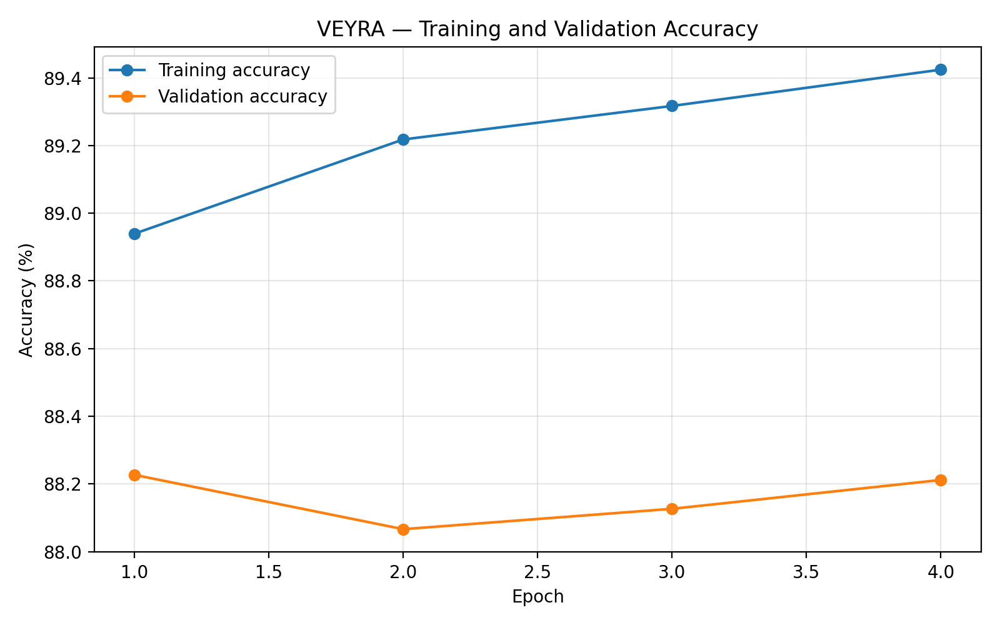
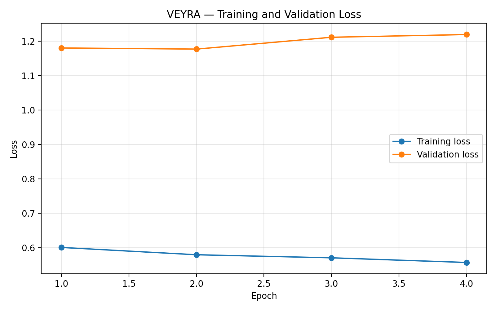
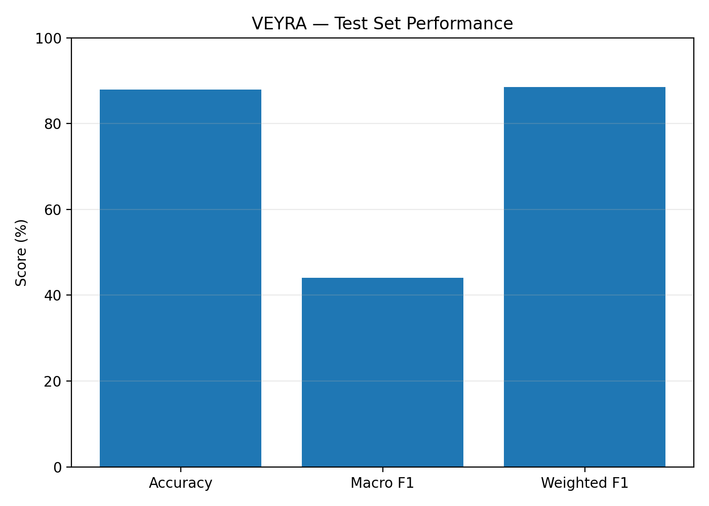
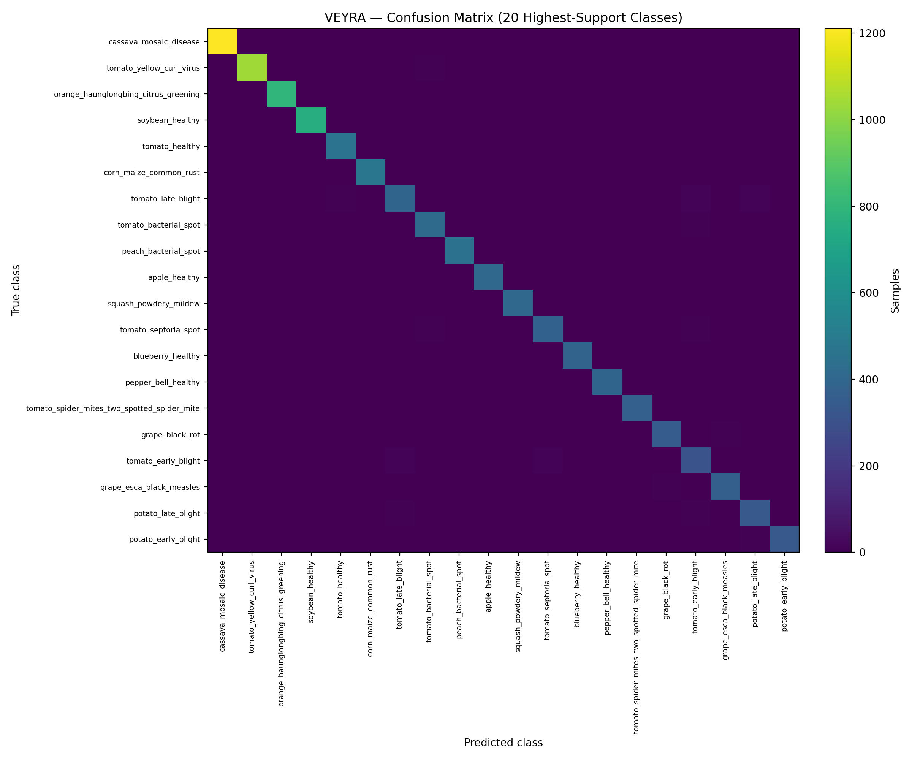

<div align="center">

# VEYRA — Crop Disease Detection
### AI-Powered Agricultural Pathogen Diagnosis via a Custom Convolutional Neural Network

[](./docs/MODEL_CARD.md)
[](./docs/EXPERIMENTS.md)
[](./docs/EXPERIMENTS.md)
[-orange.svg)](./docs/ARCHITECTURE.md)
[](./docs/API.md)
[](https://veyra-lilac-three.vercel.app/)
[](https://vriksh.onrender.com/health)

<br/>


<br/>

**VEYRA** (Visual Evaluation & Yield Risk Assessment) is an open-access crop pathology platform that diagnoses foliar diseases across **211 agricultural categories** from standard smartphone leaf photographs.

🚀 **[Open Live Web Application](https://veyra-lilac-three.vercel.app/)** • ⚡ **[Live API Health Check](https://vriksh.onrender.com/health)** • [System Architecture](./docs/ARCHITECTURE.md) • [Model Card](./docs/MODEL_CARD.md) • [Technical Project Report](./docs/REPORT.md)

</div>

---

## 1. Problem & Purpose

Plant pathogens cause an estimated 20% to 40% loss of global agricultural yield annually (FAO). In developing agrarian regions, smallholder farmers face severe diagnostic delays due to high laboratory testing costs, geographic isolation, and an extreme shortage of trained agricultural extension officers. Misdiagnosing early fungal blights as bacterial spots often results in wasted chemical expenditure and catastrophic crop failure.

**VEYRA** resolves this diagnostic bottleneck by delivering an edge-efficient, custom-architected Convolutional Neural Network (`CropDiseaseCNN`) that delivers:
* **Rapid Differential Diagnosis:** Classifies leaf photographs into top-3 ranked candidate conditions with probabilistic confidence scores in under 100 milliseconds.
* **Broad Taxonomic Coverage:** Supports 211 distinct disease and healthy categories spanning cereals, solanaceous crops, legumes, fruit orchards, and vegetables.
* **Actionable Agronomic Guidance:** Provides curated symptom explanations, biological pathogen descriptions, and organic/chemical remediation recommendations directly in the web UI.

---

## 2. Key Features Implemented

* **Custom 211-Class CNN Engine:** 703,603 parameters (2.8 MB PyTorch checkpoint) designed specifically for low-latency CPU execution.
* **Asynchronous REST Microservice:** High-throughput FastAPI backend with in-memory model caching, dual binary/MIME image validation, and strict 10 MB payload limits.
* **Drag-and-Drop Diagnostic Workspace:** Next.js 16 / React 19 web interface featuring drag-and-drop uploads, instant client-side format checks, and mobile camera support.
* **Probabilistic Top-3 Differential Results:** Ranks diagnoses by softmax probability and categorizes confidence into intuitive visual tiers (High $\ge 85\%$, Moderate $60–84\%$, Low $< 60\%$).
* **Safe Checkpoint Deserialization:** Hardened model loader utilizing PyTorch's `weights_only=True` to eliminate arbitrary code execution risks.
* **Zero-Persistence Privacy Architecture:** Uploaded photographs are processed transiently in RAM buffer streams and immediately garbage collected. No user images or biometric data are stored.

---

## 3. Verified Technology Stack

| Layer | Technologies | Deployment Environment |
| :--- | :--- | :--- |
| **Machine Learning Core** | PyTorch 2.4.1 (CPU wheel), Torchvision 0.19.1, Pillow 10.4 | In-Memory (Linux container) |
| **API Microservice** | FastAPI 0.115.5, Uvicorn 0.32.1, Python 3.11 | **Render** (Production: `https://vriksh.onrender.com`) |
| **Web Frontend** | Next.js 16.3.8 (App Router), React 19, TypeScript, Tailwind CSS, Framer Motion | **Vercel** (Production: `https://veyra-lilac-three.vercel.app`) |
| **Testing & Verification** | Python `unittest` / `test_local.py`, TypeScript Compiler (`tsc`) | Local & CI Workflows |

---

## 4. Model Architecture & Evaluation Summary

### Architecture Overview (`CropDiseaseCNN`)
* **Type:** Custom 4-Stage Deep Convolutional Neural Network
* **Feature Extractor:** 7 Conv2D layers with Batch Normalization, ReLU activations, $2 \times 2$ Max Pooling, and Adaptive Average Pooling (`(1, 1)`).
* **Classifier Head:** Flatten $\to$ Linear ($256 \to 256$) $\to$ ReLU $\to$ Dropout ($p=0.4$) $\to$ Linear ($256 \to 211$).
* **Input Tensor:** $[1, 3, 128, 128]$ (RGB, ImageNet normalized).
* **Parameters:** **703,603** (100% trainable, 2.8 MB checkpoint).

### Held-Out Test Evaluation (19,946 Samples)

Evaluated on the independent held-out test partition from the harmonized 199,377-row manifest (`reports/test_metrics.json`):

| Evaluation Metric | Score | Key Takeaway |
| :--- | :---: | :--- |
| **Overall Test Accuracy** | **87.95%** | 17,543 correct predictions out of 19,946 test samples. |
| **Weighted F1-Score** | **88.47%** | Reflected accuracy across real-world disease incidence. |
| **Weighted Precision** | **89.28%** | High positive predictive value across major crops. |
| **Weighted Recall** | **87.95%** | High sensitivity for pathogen detection. |
| **Macro F1-Score** | **44.00%** | Unweighted average across all 211 classes. |
| **Validation Accuracy (Best)** | **88.23%** | Achieved at fine-tuning Epoch 1 (`reports/training_history.csv`). |

> **Understanding the Macro vs. Weighted F1 Gap:**  
> The difference between Macro F1 (44.00%) and Weighted F1 (88.47%) stems directly from **dataset long-tail class imbalance**. While high-support categories (e.g. Citrus Greening with 802 test samples, Common Corn Rust with 477 samples) achieve $> 99\%$ F1, exactly **44 rare minority classes** have fewer than 10 test samples (down to 1–2 images), registering 0.0 F1 scores due to sample scarcity. Because Macro F1 weights every class equally regardless of support, these 44 zeros place a mathematical cap on the macro average, while Weighted F1 accurately reflects the 88.47% success rate over the query population.

---

## 5. Evaluation Graphs

<div align="center">

### Training & Validation History (FineTune_90_Target)



<br/><br/>

### Test Set Performance & Confusion Matrix (Top 20 Classes)



</div>

---

## 6. Quick Start & Local Setup

### 6.1 Prerequisites
* Python 3.10, 3.11, or 3.12
* Node.js 18.18+ or 20.x LTS & npm

### 6.2 Backend Setup & Startup
```powershell
# 1. Clone the repository
git clone https://github.com/Aayush1803/Vriksh.git
cd Vriksh/crop-disease-backend

# 2. Create and activate a virtual environment
python -m venv .venv
.\.venv\Scripts\Activate.ps1    # On Linux/macOS: source .venv/bin/activate

# 3. Install lightweight CPU dependencies (includes PyTorch CPU wheel)
pip install -r requirements.txt

# 4. Run the offline test suite (19 checks)
python test_local.py --offline

# 5. Start the FastAPI development server
uvicorn app.main:app --reload --host 0.0.0.0 --port 8000
```
Backend API will be live at: `http://localhost:8000` (Swagger docs at `/docs`).

### 6.3 Frontend Setup & Startup
```bash
# 1. Navigate to the frontend directory
cd ../veyra

# 2. Install Node dependencies
npm install

# 3. Configure local environment
echo "NEXT_PUBLIC_API_URL=http://localhost:8000" > .env.local

# 4. Start Next.js development server
npm run dev
```
Open **`http://localhost:3000`** in your browser to access the VEYRA workspace.

---

## 7. API Quick Reference

### Liveness Health Check: `GET /health`
```bash
curl -X GET https://vriksh.onrender.com/health
```
**Response (`200 OK`):**
```json
{
  "status": "ok",
  "model": "CropDiseaseCNN",
  "classes": 211,
  "model_loaded": true,
  "device": "cpu"
}
```

### Crop Disease Prediction: `POST /predict`
```bash
curl -X POST https://vriksh.onrender.com/predict \
  -F "file=@/path/to/leaf_image.jpg"
```
**Response (`200 OK`):**
```json
{
  "predicted_class": "tomato_late_blight",
  "confidence": 0.9812,
  "top_predictions": [
    { "class": "tomato_late_blight",  "confidence": 0.9812 },
    { "class": "tomato_early_blight", "confidence": 0.0143 },
    { "class": "tomato_leaf_mold",    "confidence": 0.0031 }
  ]
}
```

---

## 8. Repository Layout

```
HclProject/
├── app/                           # Active FastAPI backend package
│   ├── inference.py               # Singleton model loader & predict helper
│   ├── main.py                    # API entrypoint, routes, CORS
│   ├── model.py                   # 211-class CropDiseaseCNN architecture
│   └── classes.py                 # Legacy 38-class reference (rollback only)
├── crop-disease-backend/          # Standalone backend directory (synced)
│   ├── app/                       # FastAPI source
│   ├── models/                    # Active weights (veyra_cnn_best.pth) & config
│   ├── requirements.txt           # Production dependencies (CPU-only PyTorch)
│   ├── Procfile                   # Process start command
│   └── test_local.py              # Backend offline/online test suite
├── veyra/                         # Active Next.js 16 frontend
│   ├── app/                       # Next.js App Router (pages: /, /about, /insights)
│   ├── components/                # UI components (ResultPanel, UploadWorkspace, etc.)
│   ├── lib/                       # API client (api.ts)
│   └── package.json               # Node.js dependencies & scripts
├── docs/                          # Comprehensive technical documentation suite
│   ├── assets/                    # Evaluation graphs & diagrams
│   ├── PRD.md                     # Product Requirements Document
│   ├── ARCHITECTURE.md            # System & ML architecture
│   ├── MODEL_CARD.md              # Model card & evaluation metrics
│   ├── REPORT.md                  # Comprehensive technical project report
│   ├── API.md                     # REST API specification
│   ├── SETUP.md                   # Setup & developer guide
│   ├── DATASET.md                 # Dataset provenance & taxonomy
│   ├── EXPERIMENTS.md             # Training history & experiments
│   ├── TESTING.md                 # Verification & test suite
│   ├── DEPLOYMENT.md              # Cloud deployment architecture
│   ├── LIMITATIONS_AND_FUTURE_SCOPE.md # Limitations & future work
│   └── CHANGELOG.md               # Version changelog
├── models/                        # Root models directory
│   ├── veyra_cnn_best.pth         # Active 211-class model (2.8 MB)
│   ├── model_config.json          # 211-class mapping & metadata
│   └── best_color_model.pth       # Legacy 38-class rollback checkpoint
├── Procfile                       # Root deployment process command
├── requirements.txt               # Root Python dependencies
└── test_local.py                  # Root test runner
```

---

## 9. Comprehensive Documentation Suite

For exhaustive engineering details, consult the specialized documents inside [`docs/`](./docs/):

* 📋 **[Product Requirements Document (`docs/PRD.md`)](./docs/PRD.md)** — Functional & non-functional requirements, user personas, acceptance criteria.
* 🏗️ **[System Architecture (`docs/ARCHITECTURE.md`)](./docs/ARCHITECTURE.md)** — Component boundaries, request sequences, layer-by-layer parameter analysis, Mermaid diagrams.
* 🏷️ **[Model Card (`docs/MODEL_CARD.md`)](./docs/MODEL_CARD.md)** — Intended use, data provenance, training parameters, bias analysis.
* 📑 **[Technical Project Report (`docs/REPORT.md`)](./docs/REPORT.md)** — Full 23-section B.Tech CSE-AIML capstone academic report.
* 🔌 **[REST API Specification (`docs/API.md`)](./docs/API.md)** — Endpoints, request schemas, status codes, cURL / PowerShell / Python examples.
* 🛠️ **[Local Setup & Developer Guide (`docs/SETUP.md`)](./docs/SETUP.md)** — Step-by-step local reproduction, virtual environments, troubleshooting.
* 📊 **[Dataset Methodology (`docs/DATASET.md`)](./docs/DATASET.md)** — Source repositories, 199,377 manifest analysis, 211-class taxonomy.
* 🧪 **[Experiments & Training History (`docs/EXPERIMENTS.md`)](./docs/EXPERIMENTS.md)** — Convergence logs, loss curves, confusion matrix trace analysis.
* 🛡️ **[Testing & Verification (`docs/TESTING.md`)](./docs/TESTING.md)** — 19/19 offline checks, TypeScript validation, test matrix.
* 🚀 **[Deployment Architecture (`docs/DEPLOYMENT.md`)](./docs/DEPLOYMENT.md)** — Render backend container, Vercel edge client, environment variables.
* ⚖️ **[Limitations & Future Scope (`docs/LIMITATIONS_AND_FUTURE_SCOPE.md`)](./docs/LIMITATIONS_AND_FUTURE_SCOPE.md)** — Constraints, zero-F1 minority analysis, roadmap.
* 📜 **[Project Changelog (`docs/CHANGELOG.md`)](./docs/CHANGELOG.md)** — Verifiable version history and release logs.

---

## 10. Responsible Use & Agricultural Disclaimer

> **⚠️ Advisory Notice:**  
> VEYRA is an **educational and diagnostic decision-support utility**. It does **NOT** issue certified legal or agricultural chemical prescriptions.
> 
> * **No Automated Chemical Action:** Farmers must never apply restricted systemic agrochemicals solely based on model output without visual corroboration by an agronomist.
> * **Extension Verification:** For high-risk or quarantine pathogens, confirmation from a local government agricultural extension specialist or university laboratory is strongly recommended.
