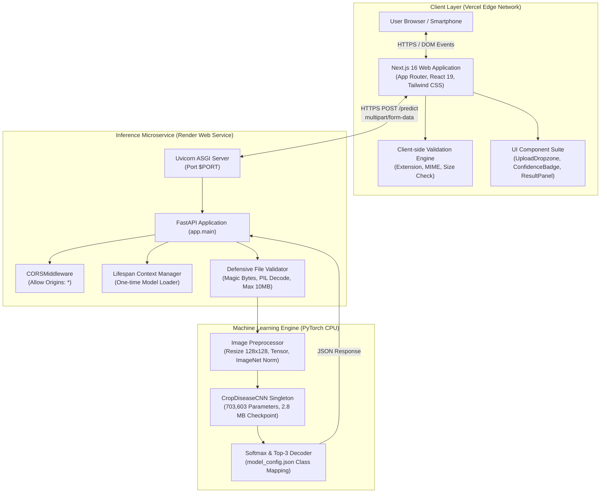
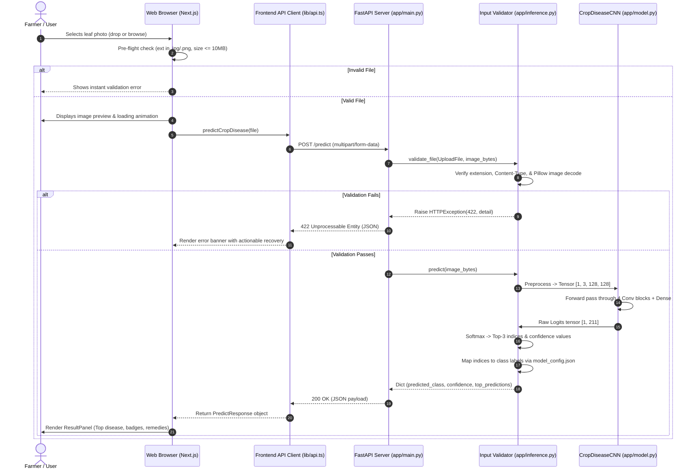
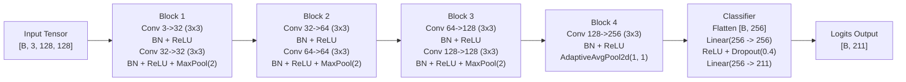
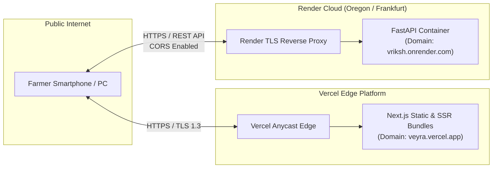

# VEYRA — System Architecture & Technical Design

**Document Version:** 2.0 (Final Release)  
**Date:** October 2026  
**Status:** Approved & Implemented  
**Core Frameworks:** Next.js 16 (React 19, TypeScript), FastAPI (Python 3.11+), PyTorch (CPU)  
**Hosting Platforms:** Vercel (Client Edge), Render (ASGI Microservice)  

---

## 1. System Context & Overview

VEYRA is organized as a decoupled, microservice-oriented web platform designed for low-latency agricultural image classification. The architecture strictly delineates presentation, network validation, feature extraction, and classification inference.



---

## 2. Component Responsibilities & Boundaries

| Component | Technology | Hosting / Environment | Key Responsibilities |
| :--- | :--- | :--- | :--- |
| **Frontend Web App** | Next.js 16, React 19, TypeScript, Tailwind CSS, Framer Motion | Vercel Edge Global CDN | Provides interactive user interface, drag-and-drop file ingestion, client-side pre-flight checks, state management, top-3 confidence visualization, and agronomic remedy rendering. |
| **API Client (`api.ts`)** | TypeScript Fetch API, AbortController | Browser Runtime | Coordinates HTTP requests to backend, manages request timeouts, translates network exceptions to structured UI errors, and parses prediction payloads. |
| **Inference Microservice** | FastAPI 0.115, Uvicorn 0.32, Python 3.11+ | Render Native Linux Web Service | Manages HTTP request lifecycle, enforces file size ($\le 10\text{ MB}$) and MIME constraints, manages model singleton memory, and exposes `/health` and `/predict`. |
| **Model Runtime** | PyTorch 2.4.1 (CPU wheel), Torchvision 0.19.1 | In-Memory (Render container) | Houses the 703,603-parameter `CropDiseaseCNN`. Performs $128 \times 128$ RGB normalization, forward pass inference, and Top-3 softmax probability computation. |
| **Model Weights & Config** | `veyra_cnn_best.pth` (2.8 MB), `model_config.json` | Local Disk $\to$ Memory | Stores trained convolutional weights, batch norm statistics, and the 211-class alphabetical mapping dictionary. |

---

## 3. Detailed Data Flow & Execution Sequences

### 3.1 End-to-End Image Prediction Flow



---

## 4. Model Architecture & Inference Pipeline

### 4.1 Neural Network Topology (`CropDiseaseCNN`)

The model is custom-designed for rapid, parameter-efficient inference on edge or cloud CPUs while preserving high spatial receptive fields:



#### Layer-by-Layer Architecture Summary:

| Stage | Layer Type | Kernel / Stride / Pad | Output Dimensions | Parameters | Activation / Regularization |
| :--- | :--- | :--- | :--- | :--- | :--- |
| **Input** | Input Tensor | - | `[1, 3, 128, 128]` | 0 | - |
| **Block 1** | Conv2D (3 $\to$ 32) | $3 \times 3$, $s=1$, $p=1$ | `[1, 32, 128, 128]` | 896 | BatchNorm2D, ReLU |
| | Conv2D (32 $\to$ 32) | $3 \times 3$, $s=1$, $p=1$ | `[1, 32, 128, 128]` | 9,248 | BatchNorm2D, ReLU |
| | MaxPool2D | $2 \times 2$, $s=2$ | `[1, 32, 64, 64]` | 0 | - |
| **Block 2** | Conv2D (32 $\to$ 64) | $3 \times 3$, $s=1$, $p=1$ | `[1, 64, 64, 64]` | 18,496 | BatchNorm2D, ReLU |
| | Conv2D (64 $\to$ 64) | $3 \times 3$, $s=1$, $p=1$ | `[1, 64, 64, 64]` | 36,928 | BatchNorm2D, ReLU |
| | MaxPool2D | $2 \times 2$, $s=2$ | `[1, 64, 32, 32]` | 0 | - |
| **Block 3** | Conv2D (64 $\to$ 128) | $3 \times 3$, $s=1$, $p=1$ | `[1, 128, 32, 32]` | 73,856 | BatchNorm2D, ReLU |
| | Conv2D (128 $\to$ 128) | $3 \times 3$, $s=1$, $p=1$ | `[1, 128, 32, 32]` | 147,584 | BatchNorm2D, ReLU |
| | MaxPool2D | $2 \times 2$, $s=2$ | `[1, 128, 16, 16]` | 0 | - |
| **Block 4** | Conv2D (128 $\to$ 256) | $3 \times 3$, $s=1$, $p=1$ | `[1, 256, 16, 16]` | 295,168 | BatchNorm2D, ReLU |
| | AdaptiveAvgPool2D | $(1, 1)$ | `[1, 256, 1, 1]` | 0 | - |
| **Classifier**| Flatten | - | `[1, 256]` | 0 | - |
| | Linear (256 $\to$ 256) | - | `[1, 256]` | 65,792 | ReLU, Dropout ($p=0.4$) |
| | Linear (256 $\to$ 211) | - | `[1, 211]` | 54,227 | Softmax (inference) |
| **Total** | **Full Network** | - | - | **703,603** | **703,603 Trainable** |

### 4.2 Preprocessing & Inference Lifecycle

1. **Byte Ingestion & Validation:** Image bytes are read into an `io.BytesIO` buffer. PIL opens the buffer and verifies image format integrity (`im.verify()`).
2. **Channel Conformance:** The image is converted to 3-channel RGB (`im.convert("RGB")`), shedding alpha channels or palette indexing.
3. **Spatial Normalization:** Resized to $128 \times 128$ bilinear pixels.
4. **Statistical Normalization:** Scaled to $[0.0, 1.0]$ floating-point tensor and normalized via standard ImageNet parameters:
   $$\text{Input} = \frac{x - \mu}{\sigma}, \quad \mu = [0.485, 0.456, 0.406], \quad \sigma = [0.229, 0.224, 0.225]$$
5. **Inference Guard:** Executed inside `torch.inference_mode()` (or `torch.no_grad()`) on the CPU device, avoiding gradient graph construction and memory bloat.
6. **Softmax & Top-3 Slicing:**
   $$P(y = c \mid \mathbf{x}) = \frac{e^{z_c}}{\sum_{j=1}^{211} e^{z_j}}$$
   `torch.topk(probabilities, k=3)` extracts the highest confidence indices, matched against the alphabetical class list from `model_config.json`.

---

## 5. API Endpoints & Request/Response Contracts

### 5.1 Health Check: `GET /health`

* **Method:** `GET`
* **Path:** `/health`
* **Response Status:**
  * `200 OK` — Model loaded and ready.
  * `503 Service Unavailable` — Server running, but model failed to load.
* **Success Schema (`200 OK`):**
```json
{
  "status": "ok",
  "model": "CropDiseaseCNN",
  "classes": 211,
  "model_loaded": true,
  "device": "cpu"
}
```

### 5.2 Prediction Endpoint: `POST /predict`

* **Method:** `POST`
* **Path:** `/predict`
* **Content-Type:** `multipart/form-data`
* **Request Parameters:**
  * `file`: Binary image file (JPEG, PNG; $\le 10\text{ MB}$).
* **Success Schema (`200 OK`):**
```json
{
  "predicted_class": "tomato_late_blight",
  "confidence": 0.9812,
  "top_predictions": [
    { "class": "tomato_late_blight",  "confidence": 0.9812 },
    { "class": "tomato_early_blight", "confidence": 0.0143 },
    { "class": "tomato_leaf_mold",    "confidence": 0.0031 }
  ]
}
```

* **Error Response Matrix:**

| Status Code | Reason | Example Response Body |
| :--- | :--- | :--- |
| `422 Unprocessable Entity` | Unsupported file extension | `{"detail": "Unsupported file extension '.bmp'. Allowed: .jpg, .jpeg, .png"}` |
| `422 Unprocessable Entity` | File size exceeds 10 MB | `{"detail": "File size (12.4 MB) exceeds 10 MB limit."}` |
| `422 Unprocessable Entity` | Corrupt or invalid image bytes | `{"detail": "Corrupt or unreadable image file."}` |
| `503 Service Unavailable` | Model checkpoint unavailable | `{"detail": "Model is not loaded. Please contact server administrator."}` |
| `500 Internal Server Error` | Unhandled backend exception | `{"detail": "Internal inference error: ..."}` |

---

## 6. Deployment Topology & Security Architecture



### 6.1 Security & Resource Management
1. **Zero-Persistence Privacy:** Neither the frontend nor the backend stores images in cookies, local storage, databases, or object storage (S3). All image data is transiently processed in RAM and discarded immediately.
2. **Denial-of-Service Defense:** Request streaming in FastAPI inspects file length before consuming the buffer; uploads $> 10\text{ MB}$ abort immediately.
3. **Safe Checkpoint Deserialization:** The backend uses `torch.load(..., weights_only=True)` to prevent arbitrary code execution during model weight loading.
4. **Environment Isolation:** Configuration keys (e.g. `NEXT_PUBLIC_API_URL`) are injected at build/runtime without exposing sensitive server paths.
