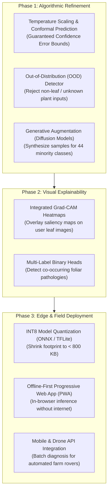

# LEAFORA — Known Limitations & Future Scope

**Document Version:** 2.0 (Final Release)  
**Date:** October 2026  
**Status:** Approved & Documented  

---

## 1. Technical & Algorithmic Limitations

While LEAFORA represents a significant advancement over legacy 38-class lab prototypes, rigorous engineering requires acknowledging current systemic constraints.

### 1.1 Long-Tail Class Imbalance & Zero-F1 Minority Categories
* **Empirical Reality:** In the 211-class taxonomy, **44 minority classes** achieved an F1-score of 0.0 on the held-out test split.
* **Underlying Cause:** Severe class imbalance in open-access agricultural repositories. Classes such as `tomato_two_spotted_spider_mites`, `raspberry_spot`, `plum_pocket_disease`, and `wheat_wheat_septoria_blotch` contain fewer than 10 test samples (and proportionately few training samples).
* **System Impact:** For high-frequency diseases (e.g. citrus greening, common corn rust), LEAFORA functions with $> 99\%$ accuracy. For long-tail minority classes, the model exhibits low sensitivity, often misclassifying rare lesions as visually similar high-support conditions.

### 1.2 Softmax Calibration & Out-of-Distribution Vulnerability
* **Overconfidence on Novel Inputs:** Deep convolutional networks trained with standard cross-entropy loss are prone to producing uncalibrated, overconfident probability outputs on out-of-distribution (OOD) images. If a user uploads a photograph of a non-crop leaf, weed, or completely unrelated textured surface (e.g. green fabric), the model will force the input into one of its 211 classes.
* **Absence of an Explicit "Unknown/Non-Plant" Class:** The current classifier operates under a closed-world assumption ($P \in \Delta^{210}$).

### 1.3 Laboratory vs. In-Field Background Bias
* **Domain Shift:** Substantial portions of the training corpus derive from laboratory conditions (leaves detached and photographed against neutral monochrome backdrops).
* **Field Clutter:** In real-world field settings, photographs often include surrounding soil, weed foliage, shadows from neighboring trees, dew droplets, and finger occlusions holding the leaf. These extraneous visual artifacts can degrade classification confidence.

### 1.4 Single-Pathogen Diagnostic Paradigm
* **Co-Infection Blindness:** Agricultural crops frequently exhibit concurrent dual infections (e.g., Early Blight and Septoria Leaf Spot coexisting on a single tomato leaflet). Because LEAFORA is formulated as a single-label multi-class network, it identifies only the dominant visual symptom.
* **Foliar Siting Limitation:** The model only diagnoses diseases that manifest visually on foliage. Soil-borne root rots, vascular wilts prior to leaf chlorosis, and subterranean nematode infestations cannot be diagnosed from leaf photographs alone.

---

## 2. Responsible Use & Operational Disclaimers

> ### ⚠️ Responsible Use Notice
> LEAFORA is engineered as an **educational and diagnostic decision-support utility**. It does **NOT** constitute a certified legal or agricultural prescription.
> 
> * **No Automated Chemical Application:** Farmers must never execute large-scale applications of toxic, restricted, or expensive chemical fungicides solely based on model output without secondary human validation.
> * **Local Extension Verification:** In cases of severe economic risk or quarantine pathogens (e.g. citrus greening, late blight outbreaks), diagnoses must be corroborated by a local government agricultural extension officer or university plant pathology laboratory.

---

## 3. Future Scope & Roadmap

To evolve LEAFORA from a high-performance diagnostic prototype into an enterprise-grade agricultural AI system, the following roadmap is proposed:

### 3.1 Confidence Calibration & OOD Detection
* Implement **Temperature Scaling** on logits to align predicted softmax probabilities with true empirical correctness rates.
* Train an auxiliary binary discriminator or Mahalanobis distance OOD filter to reject non-leaf images with an explicit `"Input not recognized as a crop leaf"` error.

### 3.2 Visual Explainability (Grad-CAM Integration)
* Integrate Gradient-weighted Class Activation Mapping (Grad-CAM) directly into the Next.js results panel. This will render an interactive visual heatmap over the user's uploaded photograph, highlighting exactly which necrotic spots or chlorotic margins guided the CNN's decision.

### 3.3 Synthetic Minority Oversampling
* Utilize modern latent diffusion models conditioned on botanical pathology prompts to synthesize photorealistic training samples for the 44 minority classes, closing the long-tail performance gap.

### 3.4 Offline Edge Deployment (PWA / ONNX Runtime)
* Export `CropDiseaseCNN` to ONNX and quantize weights from FP32 to INT8, reducing model size from 2.8 MB to under 800 KB.
* Execute inference directly in the user's browser using `onnxruntime-web` (WebAssembly / WebGPU), allowing farmers in remote rural regions with zero cellular connectivity to diagnose crops entirely offline.
