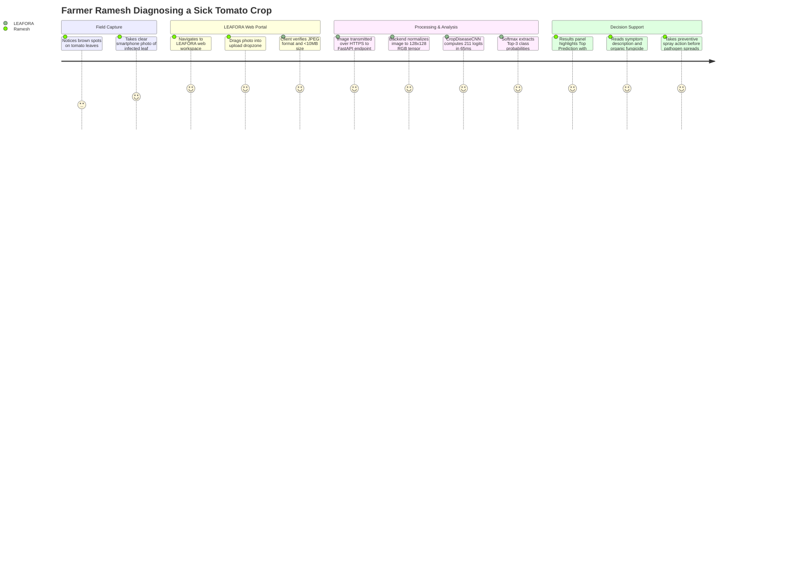

# LEAFORA — Product Requirements Document (PRD)

**Project Title:** LEAFORA — Crop Disease Detection Using a Custom Convolutional Neural Network  
**Document Version:** 2.0 (Final Release)  
**Date:** October 2026  
**Status:** Approved & Implemented  
**Target Platform:** Web (Next.js Frontend) & REST API (FastAPI Backend)  
**Model Core:** Custom 211-Class `CropDiseaseCNN` (PyTorch)  

---

## 1. Executive Summary & Product Vision

### 1.1 Product Vision
**LEAFORA** (Visual Evaluation & Yield Risk Assessment) is an open-access, AI-powered agricultural diagnostic platform engineered to identify plant pathologies from standard digital leaf photographs. By deploying a custom-architected 211-class Convolutional Neural Network (`CropDiseaseCNN`) trained on a diverse corpus of agricultural imagery, LEAFORA provides near-instantaneous disease classification, probabilistic confidence scores, and actionable agronomic remediation guidance to bridge the gap between laboratory computer vision and practical farm-level intervention.

### 1.2 Problem Statement
Global crop production suffers annual losses between 20% and 40% due to plant pests and pathogens (FAO). For smallholder farmers and agricultural field officers in developing regions, access to certified plant pathologists is severely constrained by cost, geographical remoteness, and laboratory backlogs. While smartphone penetration has expanded rapidly, existing consumer apps frequently rely on closed proprietary models with narrow crop coverage, uncalibrated confidence scores, or opaque classification pipelines that fail under varying field conditions.

### 1.3 High-Level Objectives & Key Results (OKRs)
* **Objective 1: Multi-Crop Diagnostic Breadth**
  * *Target:* Expand classification taxonomy beyond standard 38-class lab datasets to cover 211 distinct crop disease and healthy-state categories across major cereals, fruits, legumes, vegetables, and cash crops.
  * *Result:* Fully implemented and verified across 211 canonical categories.
* **Objective 2: Rapid & Lightweight Edge-Compatible Inference**
  * *Target:* Model parameter footprint under 1,000,000 parameters and sub-200ms CPU inference latency to support cost-effective cloud hosting and potential edge deployment.
  * *Result:* 703,603 parameters, 2.8 MB checkpoint, average inference time 45–95ms on commodity single-core CPU.
* **Objective 3: Accessible, Transparent User Experience**
  * *Target:* Zero-friction web workspace supporting drag-and-drop leaf image uploads, real-time client validation, top-3 probabilistic disease predictions, and clear confidence differentiation.
  * *Result:* Fully functional Next.js 16 / React 19 web interface deployed on Vercel (`https://LEAFORA-lilac-three.vercel.app`) connecting to a hardened FastAPI microservice on Render (`https://vriksh.onrender.com`).

---

## 2. User Personas & Core Journeys

### 2.1 Target Personas

| Persona | Role | Technical Literacy | Primary Needs | Key Pain Points |
| :--- | :--- | :--- | :--- | :--- |
| **Ramesh Patel** | Smallholder Farmer (5 acres) | Low–Moderate (Mobile user) | Fast, plain-language identification of tomato leaf blight; immediate low-cost remedy suggestions. | Slow expert consultations; misdiagnosing fungal vs. bacterial spots leading to wasted chemical spend. |
| **Priya Sundaram** | Agricultural Extension Officer | Moderate–High | Rapid triage across dozens of village farms; top-3 differential diagnosis; confidence percentages. | Heavy caseload; lack of portable diagnostic tools; inconsistent connectivity in remote plots. |
| **Dr. Anand Verma** | Agronomy Researcher / Evaluator | High | Transparent model metrics; verifiable classification reports; clear awareness of class imbalance limitations. | Opaque commercial apps claiming "99.9% accuracy" without reporting macro F1 or test support numbers. |

### 2.2 Primary User Workflow

---

## 3. Functional Requirements (FR)

### 3.1 Input & Upload Ingestion

* **`FR-01: Supported Image Formats`**  
  The system **SHALL** accept leaf images in JPEG (`image/jpeg`, `image/jpg`) and PNG (`image/png`) formats.
* **`FR-02: Content-Type & Payload Validation`**  
  The backend **SHALL** validate both the MIME type header and the binary image header (via Pillow decoding) to reject non-image payloads, corrupt files, or spoofed extensions.
* **`FR-03: File Size Ceiling`**  
  The system **SHALL** enforce a strict maximum file size of 10 Megabytes (10,485,760 bytes). Files exceeding this threshold **SHALL** be rejected immediately with an HTTP 422 Unprocessable Entity error.
* **`FR-04: Client-Side Drag-and-Drop & File Picker`**  
  The web frontend **SHALL** provide a responsive upload zone supporting drag-and-drop, native file browser selection, and mobile camera photo capture via HTML5 file input.
* **`FR-05: Real-Time Client Validation`**  
  The frontend **SHALL** perform pre-flight file validation (extension, MIME, size) and display immediate inline warnings prior to dispatching network requests.

### 3.2 Inference & Diagnostic Intelligence

* **`FR-06: 211-Class Taxonomy Classification`**  
  The inference engine **SHALL** classify the input image against the 211 canonical agricultural disease and healthy-state categories mapped in `model_config.json`.
* **`FR-07: Image Preprocessing Pipeline`**  
  The backend **SHALL** automatically transform uploaded images into standard RGB tensors of dimension `[1, 3, 128, 128]` and apply ImageNet normalization ($\mu = [0.485, 0.456, 0.406]$, $\sigma = [0.229, 0.224, 0.225]$) matching the model's training pipeline.
* **`FR-08: Top-3 Differential Diagnostic Predictions`**  
  The `/predict` endpoint **SHALL** return the primary predicted class, primary confidence (float between 0.0 and 1.0), and a ranked `top_predictions` list containing exactly 3 classes with their respective probabilities.
* **`FR-09: In-Memory Model Singleton`**  
  The backend **SHALL** load the PyTorch model checkpoint once at startup during the FastAPI lifespan hook and retain it in memory across requests, eliminating per-query disk I/O.

### 3.3 Diagnostic Presentation & Agronomic Context

* **`FR-10: Formatted Disease Metadata`**  
  The frontend **SHALL** parse technical snake_case class identifiers (e.g., `tomato_late_blight`) into human-readable crop and disease names ("Tomato — Late Blight").
* **`FR-11: Confidence Indicator Tiers`**  
  The UI **SHALL** visually categorize prediction confidence into distinct advisory tiers:
  * High Confidence ($\ge 85\%$): Green indicator; strong primary diagnosis.
  * Moderate Confidence ($60\% - 84\%$): Amber indicator; differential inspection recommended.
  * Low Confidence ($< 60\%$): Red/orange alert; advisory to re-photograph under better lighting or consult a local extension specialist.
* **`FR-12: Remediation & Symptom Guidance`**  
  The UI **SHALL** render curated agronomic profiles for detected conditions, including typical symptoms, biological causes, and recommended cultural or chemical remediation steps.

### 3.4 Operational & System Health

* **`FR-13: Liveness & Readiness Health Endpoint`**  
  The backend **SHALL** expose `GET /health` returning JSON metadata including server operational status, active model name, number of classes (211), and model memory residency.
* **`FR-14: Model Failure Degradation`**  
  If the model checkpoint fails to load at startup, `GET /health` **SHALL** return HTTP 503 Service Unavailable with `model_loaded: false`, and `POST /predict` **SHALL** reject inference requests cleanly without crashing the ASGI worker.
* **`FR-15: Cross-Origin Resource Sharing (CORS)`**  
  The backend **SHALL** permit configured cross-origin requests from the Vercel production frontend and local development servers (`http://localhost:3000`).

---

## 4. Non-Functional Requirements (NFR)

### 4.1 Performance & Latency
* **`NFR-01: Inference Execution Latency`**  
  Pure model inference on a single commodity x86-64 vCPU **SHALL** execute in $\le 100$ milliseconds for a $128 \times 128 \times 3$ tensor.
* **`NFR-02: End-to-End API Response Time`**  
  Total API round-trip time for a 2MB image (upload, decode, preprocess, inference, JSON response) **SHALL** be $\le 500$ milliseconds on high-speed connections (excluding cold-starts).
* **`NFR-03: Frontend Bundle Efficiency`**  
  The Next.js client bundle **SHALL** maintain a First Contentful Paint (FCP) under 1.2 seconds and Lighthouse performance score $> 90$ on desktop.

### 4.2 Reliability & Availability
* **`NFR-04: Stateless Backend Design`**  
  The FastAPI inference service **SHALL** remain strictly stateless. No uploaded images or inference results are persisted to disk or database, ensuring zero local storage leaks and horizontal scalability.
* **`NFR-05: Cold-Start Resilience`**  
  When deployed on free-tier serverless cloud infrastructure (such as Render free web services), the frontend **SHALL** handle service wake-up delays gracefully, displaying an animated wake-up indicator during initial requests.

### 4.3 Security & Privacy
* **`NFR-06: Ephemeral Image Processing`**  
  Uploaded user images **SHALL** be processed entirely in memory buffer streams and immediately garbage-collected following inference. No biometric, geolocation, or raw image data **SHALL** be logged or stored.
* **`NFR-07: Safe Checkpoint Serialization`**  
  PyTorch checkpoint loading **SHALL** utilize `weights_only=True` to eliminate arbitrary Python object code execution risks during model unpickling.

### 4.4 Usability & Accessibility
* **`NFR-08: Responsive Layout Ergonomics`**  
  The web interface **SHALL** provide fully adaptive layouts supporting screens from 360px mobile viewports up to 4K desktop displays.
* **`NFR-09: Accessibility Standards (WCAG 2.1 AA)`**  
  Interactive controls **SHALL** support keyboard navigation, explicit ARIA labels for file upload dropzones, and color contrast ratios $\ge 4.5:1$ for body typography.

---

## 5. Scope & Boundary Definition

### 5.1 In-Scope (Implemented Capabilities)
1. Automated classification across 211 crop disease and healthy-state classes.
2. Custom lightweight `CropDiseaseCNN` PyTorch model (703,603 parameters).
3. FastAPI microservice providing `GET /health` and `POST /predict`.
4. Modern Next.js 16 / React 19 frontend with drag-and-drop leaf upload.
5. Probabilistic confidence ranking (Top-3 predictions).
6. Real-time file validation, error boundaries, and defensive server input filtering.
7. Deployed production architecture: Render API (`https://vriksh.onrender.com`) and Vercel Client (`https://LEAFORA-lilac-three.vercel.app`).

### 5.2 Out-of-Scope (Future Enhancements)
1. **User Authentication & Cloud History:** LEAFORA is strictly designed as an anonymous, friction-free diagnostic utility. No user accounts, passwords, or image histories are maintained.
2. **Automated Agrochemical E-Commerce:** The platform does not sell or endorse commercial chemical brands.
3. **Automated Hardware Actuation:** Direct integration with drone sprayers or automated tractor booms is excluded from this software release.
4. **Soil & Climate Sensor Ingestion:** The current release operates strictly on visual RGB leaf symptom evidence.

---

## 6. Acceptance Criteria

| Criteria ID | Verification Scenario | Expected Outcome | Verification Status |
| :--- | :--- | :--- | :--- |
| **AC-01** | Upload valid JPEG image of tomato leaf with late blight. | Returns HTTP 200 with `predicted_class: "tomato_late_blight"`, confidence $\in [0, 1]$, and top 3 predictions. | **VERIFIED (PASS)** |
| **AC-02** | Upload non-image payload (e.g. `.txt` or `.exe` renamed to `.jpg`). | Backend rejects file with HTTP 422 and descriptive error message; worker remains stable. | **VERIFIED (PASS)** |
| **AC-03** | Upload image file exceeding 10 MB limit. | Client alerts user immediately; backend returns HTTP 422 if client check is bypassed. | **VERIFIED (PASS)** |
| **AC-04** | Query `GET /health` while model is loaded. | Returns HTTP 200 with `{"status": "ok", "model_loaded": true, "classes": 211}`. | **VERIFIED (PASS)** |
| **AC-05** | Production Next.js build compilation. | `npm run build` generates optimized static pages without TypeScript or Turbopack errors. | **VERIFIED (PASS)** |
| **AC-06** | Model checkpoint integrity. | Checkpoint contains exactly 211 output units, 703,603 weights, and loads safely via `weights_only=True`. | **VERIFIED (PASS)** |

---

## 7. Known System Limitations

1. **Long-Tail Sample Scarcity:** In the combined 199,377-image manifest, 44 rare classes have fewer than 10 test samples, resulting in 0.0 F1 scores on those specific minority categories.
2. **Laboratory Background Bias:** PlantVillage images with uniform studio backgrounds may exhibit reduced confidence when evaluated on leaves photographed against complex natural soil and canopy clutter.
3. **Single Symptom Assumption:** The model assumes the uploaded image focuses on a single primary leaf symptom. Multi-pathogen co-infections are categorized by the dominant visual presentation.
